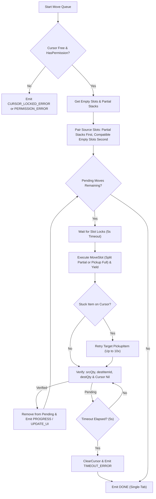

# LibItemMove-1.0 Library Design

## 1. Core Abstractions & Data Structures

- **Slot Identifier (`SlotId`)**: Do not use objects/tables to represent slots
  (this causes Garbage Collection spikes). Instead, pack the two indices into a
  single integer:
  $$\text{SlotId} = (\text{BagID} \times 1000) + \text{SlotIndex}$$
  - **`encode_bagslot(bag, slot)`**: Converts a separate `bag` index and `slot`
    index into a packed `SlotId` integer: `bag * 1000 + slot`.
  - **`decode_bagslot(slotId)`**: Unpacks the single `SlotId` integer back into
    its constituent `bag` and `slot` numbers: `bag = math.floor(slotId / 1000)`
    and `slot = slotId % 1000`.

> [!WARNING]
> Older addons (like BankStack) historically used a multiplier of 100 (e.g.,
> `bag * 100 + slot`). This is **deprecated and unsafe** in modern World of
> Warcraft. A multiplier of **1000** is mandatory because bags and bank tabs
> can now hold 100 or more slots, which causes ID collisions with a 100
> multiplier.

- **Move Context Class**: Strategy tables inheriting from `BaseContext`
  (`contexts/base_context.lua`) for each transfer direction (`BagToBank`,
  `BankToBag`, `BagToGuildBank`, `GuildBankToBag`, `BagToWarbank`,
  `WarbankToBag`). Each context exposes:
  - `isGuildBank`, `isWarbank`
  - `HasPermission()`
  - `MoveSlot(fromSlotId, toSlotId, quantity)`
  - `PickupItem(bag, slot)`
  - `GetSlotQuantity(slotId)`, `GetSourceSlotQuantity(slotId)`,
    `GetTargetSlotQuantity(slotId)`
  - `GetSlotItemId(bag, slot)`, `GetSourceSlotItemId(bag, slot)`,
    `GetTargetSlotItemId(bag, slot)`
  - `IsSlotLocked(bag, slot)`, `IsSourceSlotLocked(bag, slot)`,
    `IsTargetSlotLocked(bag, slot)`
  - `GetBagFamily(bag)`, `GetItemIdFromString(itemString)`
  - `GetEmptySlots(emptySlotIdsTable)`
  - `GetPartialSlots(itemString, partialSlotsTable)`
  - `SlotIterator(itemString)` / `SlotIdIterator(itemString)`

---

## 2. WoW API Adapter (Retail & Classic Compatibility)

Wrap Blizzard API interactions in `core/api_adapter.lua` to ensure cross-version
compatibility across Classic Era (`1.15.x`), MoP Classic (`5.5.x`), WoW Forever
(`1.60.x`), and modern Retail (`11.x`/`12.x`). Beyond slot operations,
`APIAdapter` also centralizes container discovery (`GetPlayerBagIDs`,
`GetBankContainerIDs`, `GetWarbankContainerIDs`, `GetContainerNumSlots`),
specialty resolution (`GetBagItemFamily`, `IsCraftingReagent`), and bank type
filtering (`IsItemAllowedInBankType`):

| Action                      | WoW API (Modern / Classic Fallback)                                        | Details / Safety Checks                                                                          |
| :-------------------------- | :------------------------------------------------------------------------- | :----------------------------------------------------------------------------------------------- |
| **Get Stack Count**         | `C_Container.GetContainerItemInfo(bag, slot)` / `GetContainerItemInfo`     | Normalized to `{ stackCount, isLocked, itemID, isBound, itemLink }`. Nil if empty.               |
| **Split Container Item**    | `C_Container.SplitContainerItem(bag, slot, count)` / `SplitContainerItem`  | Places `count` items from a partial stack onto the cursor.                                       |
| **Pick up Container Item**  | `C_Container.PickupContainerItem(bag, slot)` / `PickupContainerItem`       | Picks up full stack or swaps/drops item on cursor with destination slot.                         |
| **Split Guild Bank Item**   | `SplitGuildBankItem(tab, slot, count)`                                     | Places `count` items from a Guild Bank partial stack onto the cursor.                            |
| **Pick up Guild Bank Item** | `PickupGuildBankItem(tab, slot)`                                           | Picks up full stack or swaps/drops item on cursor with Guild Bank tab slot.                      |
| **Check Cursor**            | `GetCursorInfo()`                                                          | Returns `"item"`, `"money"`, etc. Checked before moves, during recovery, and in verification.    |
| **Clear Cursor**            | `ClearCursor()`                                                            | Returns held cursor items to their source slots (does not destroy items). Run on cleanup/errors. |

---

## 3. Step-by-Step Move Algorithm

Your implementation must follow this exact transaction lifecycle:



### Step 3.1: Pre-Move Validation & Filtering

1. **Cursor Safety**: Verify that `GetCursorInfo() == nil` before starting and
   again right before issuing a move. If the cursor holds an item, emit
   `CURSOR_LOCKED_ERROR` and abort immediately to avoid overwriting or
   misplacing the player's held item.
2. **Permission Checks**: Call `context:HasPermission()` before scanning slots.
   - `BagToBank` / `BankToBag`: Check `C_Bank.CanUseBank(Enum.BankType.Character)`
     when `C_Bank` is available.
   - `BagToWarbank` / `WarbankToBag`: Check `C_Bank.CanUseBank(Enum.BankType.Account)`
     and fail closed when `C_Bank` is unavailable.
   - `BagToGuildBank` / `GuildBankToBag`: Check `C_GuildBank.IsGuildBankEnabled()`
     and `GetGuildBankTabInfo` deposit or withdrawal rights on the active tab.
3. **Deposit Eligibility & Soulbound Checks**:
   - **Guild Bank (`BagToGuildBank`)**: Verify
     `C_Container.GetContainerItemInfo(bag, slot).isBound` is false. Soulbound
     items cannot be deposited.
   - **Character Bank (`BagToBank`) & Warbank (`BagToWarbank`)**: Filter source
     slots with `C_Bank.IsItemAllowedInBankType(bankType, itemLocation)` when
     available so Warbound (`isBound == true`) items can enter the Warbank while
     restricted items are skipped cleanly.

### Step 3.2: Partial Consolidation & Empty Slot Prioritization

Before assigning empty slots, `MoveThread` scans target containers via
`context:GetPartialSlots` to fill existing compatible partial stacks first. To
prevent general items from cluttering specialized bags (e.g., Herb bags, Mining
bags, Reagent bags):

1. `APIAdapter.GetBagItemFamily(bag)` resolves bag families in priority order:
   - Query `C_Container.GetContainerNumFreeSlots(bag)` first (forcing Retail /
     WoW Forever Reagent Bag `5` to family `2048` / `0x800` if it reports `0` or
     is unavailable).
   - Return `0` immediately for modern virtual Character Bank or Warbank tabs
     without calling `ContainerIDToInventoryID`.
   - Fall back to `C_Container.ContainerIDToInventoryID(bag)` (or global
     `ContainerIDToInventoryID`) followed by `GetInventoryItemID` and
     `GetInventoryItemLink` on legacy physical containers.
2. Map empty slots to their bag family and sort them: specialized bags
   (`family ~= 0`) before general bags (`family == 0`).
3. Pair an item with an empty slot via `Utils.IsFamilyCompatible`: general bags
   (`0`) accept any item; Reagent Bags (`2048`) require `isCraftingReagent == true`
   (the 17th return of `C_Item.GetItemInfo` / `GetItemInfo`); other specialty
   bags require a non-zero `bit.band(itemFamily, bagFamily)` match.

### Step 3.3: Execution & The Cooperative Yield Loop

All moves run inside a coroutine scheduler (`core/scheduler.lua`):

1. **Split vs. Pickup Commands**: Use
   `C_Container.SplitContainerItem(fromBag, fromSlot, quantity)` (or
   `SplitGuildBankItem` for Guild Bank) only when splitting a partial stack
   (`currentQty > 1 and quantity < currentQty`). For full stacks or single /
   unstackable items, call `C_Container.PickupContainerItem` (or
   `PickupGuildBankItem`) to pick up the slot directly onto the cursor.
2. **Cursor Placement**: Immediately after the source pickup or split, `MoveSlot`
   calls `PickupContainerItem(toBag, toSlot)` or
   `PickupGuildBankItem(toTab, toSlot)` to place the item into the target slot.
3. **Clear Cursor**: Clear any stray cursor item with `ClearCursor()` before
   initiating a move step, and call `ClearCursor()` on lock timeouts,
   verification timeouts, mid-loop cursor errors, or coroutine errors (not
   immediately after `MoveSlot`, so stuck-cursor recovery can inspect and retry
   the held item).
4. **Cooperative Yielding**: Yield execution using the native Lua standard
   `coroutine.yield()` function (which is built into WoW's Lua API sandbox
   environment) after triggering a move. This yields control back to your
   scheduler on the main frame update hook (e.g. `OnUpdate`), giving the game
   client time to communicate with the server and fire container events.
5. **Cursor Lock Recovery (Retry Loop)**: If `GetCursorInfo() == "item"` after
   yielding (due to latency dropping the placement click), verify the cursor item
   ID matches `expectedId`. Repeat `context:PickupItem(tBag, tSlot)` up to 10
   times, yielding between retries, before continuing into the verification loop
   (where `GetCursorInfo() == nil` will remain false until the 5-second timeout
   if the item stays stuck).

### Step 3.4: Guild Bank Rate-Limit Throttling

- **Throttling Constraint**: Blizzard severely limits the speed of Guild Bank
  operations. You **MUST NOT** issue multiple Guild Bank moves in the same
  cycle.
- **Throttling Solution**: When moving to/from a Guild Bank, execute **only one
  move per verification cycle**, wait for that transaction to verify, and yield
  for a **0.2-second post-verification cooldown** before initiating the next.

### Step 3.5: Transaction Verification & Timeouts

Do not assume a move succeeded because the functions returned. You must verify
it:

1. Define a **5-second** timeout (both for pre-move slot lock waiting and for
   post-move verification).
2. Calculate the expected remaining quantity in the source slot and expected
   destination stack count:
   $$\text{ExpectedQty} = \max(\text{StartQty} - \text{MovedQty}, 0)$$
3. In a loop, yield execution and inspect both source and target slots.
4. Confirm all four conditions unconditionally (including on stack merges):
   - Source slot quantity $\le \text{endQty}$.
   - Target slot item ID matches the expected item ID.
   - Target slot quantity $\ge \text{expectedDestQty}$ (accumulated across
     sequential partial-stack merges into the same slot).
   - Cursor is empty (`GetCursorInfo() == nil`).
5. If verified, remove the move from `pending`, emit `PROGRESS` and `UPDATE_UI`,
   and continue.
6. If the 5-second timeout expires, log `TIMEOUT DETAILS`, clear the cursor with
   `ClearCursor()`, and emit `TIMEOUT_ERROR`.

### Step 3.6: Guild Bank Multi-Tab Orchestration

When a multi-tab queue is detected for a Guild Bank context:

1. The scheduler runs the sequential process inside `Mover.MoveMultiTabThread`,
   checking `GetCursorInfo() == nil` and `C_GuildBank.IsGuildBankEnabled()`
   upfront.
2. For each sorted target tab, it checks `GetCurrentGuildBankTab()`. If it does
   not match:
   - It creates a temporary frame to listen to `GUILDBANKBAGSLOTS_CHANGED`.
   - It calls `SetCurrentGuildBankTab` and `QueryGuildBankTab` to trigger
     server-side content updates.
   - It yields the thread frame-by-frame until the event fires or a 2-second
     wait expires, then unregisters and hides the frame and proceeds into
     `Mover.MoveThread`.
3. It calls `Mover.MoveThread` synchronously for the items belonging to that tab
   index, suppressing intermediate `"DONE"` events.
4. Any error emitted by `Mover.MoveThread` (`TIMEOUT_ERROR`,
   `CURSOR_LOCKED_ERROR`, `PERMISSION_ERROR`) aborts the remaining tabs without
   emitting `"DONE"`.

---

## Core Mover Reference Flow

`mover.lua` implements the cooperative thread engine with the following structure:

```lua
local Mover = {}

function Mover.MoveThread(moveQueue, context, callback, dispatchGlobalEvent)
    if APIAdapter.GetCursorInfo() ~= nil then
        NotifyCallback(callback, dispatchGlobalEvent, "CURSOR_LOCKED_ERROR")
        return
    end
    if type(context.HasPermission) == "function" and not context:HasPermission() then
        NotifyCallback(callback, dispatchGlobalEvent, "PERMISSION_ERROR")
        return
    end

    local emptySlots = {}
    context:GetEmptySlots(emptySlots) -- Sorted: specialized bags first

    local pending = {}
    for itemString, qtyToMove in pairs(moveQueue) do
        local remainingToMove = qtyToMove
        local partialSlots = {}
        context:GetPartialSlots(itemString, partialSlots)

        for _, srcIdx, currentQty in context:SlotIterator(itemString) do
            local workingQty = currentQty
            if remainingToMove > 0 then
                for _, pData in ipairs(partialSlots) do
                    if remainingToMove > 0 and workingQty > 0 and pData.roomLeft > 0 then
                        local moveQty = math.min(workingQty, remainingToMove, pData.roomLeft)
                        table.insert(pending, {
                            src = srcIdx,
                            target = pData.slotId,
                            qty = moveQty,
                            endQty = math.max(workingQty - moveQty, 0),
                            item = itemString,
                            isPartial = true,
                            expectedDestQty = pData.currentQty + moveQty
                        })
                        remainingToMove = remainingToMove - moveQty
                        workingQty = workingQty - moveQty
                        pData.roomLeft = pData.roomLeft - moveQty
                        pData.currentQty = pData.currentQty + moveQty
                    end
                end

                if remainingToMove > 0 and workingQty > 0 then
                    local targetSlotId = Mover.FindTargetSlot(itemString, emptySlots, context)
                    if targetSlotId then
                        local moveQty = math.min(workingQty, remainingToMove)
                        table.insert(pending, {
                            src = srcIdx,
                            target = targetSlotId,
                            qty = moveQty,
                            endQty = math.max(workingQty - moveQty, 0),
                            item = itemString,
                            isPartial = false,
                            expectedDestQty = moveQty
                        })
                        remainingToMove = remainingToMove - moveQty
                    end
                end
            end
        end
    end

    while next(pending) do
        local movedSlotId = nil

        for moveIndex, moveData in pairs(pending) do
            if APIAdapter.GetCursorInfo() then APIAdapter.ClearCursor() end
            local sBag, sSlot = Utils.decode_bagslot(moveData.src)
            local tBag, tSlot = Utils.decode_bagslot(moveData.target)

            -- Wait up to 5s for source/target slot locks to clear
            local lockTimeout = GetTime() + 5
            while (context.IsSourceSlotLocked and context:IsSourceSlotLocked(sBag, sSlot)) or
                  (context.IsTargetSlotLocked and context:IsTargetSlotLocked(tBag, tSlot)) do
                if GetTime() >= lockTimeout then
                    APIAdapter.ClearCursor()
                    NotifyCallback(callback, dispatchGlobalEvent, "TIMEOUT_ERROR")
                    return
                end
                coroutine.yield()
            end

            if APIAdapter.GetCursorInfo() ~= nil then
                APIAdapter.ClearCursor()
                NotifyCallback(callback, dispatchGlobalEvent, "CURSOR_LOCKED_ERROR")
                return
            end

            context:MoveSlot(moveData.src, moveData.target, moveData.qty)
            coroutine.yield()

            -- Stuck Cursor Recovery (up to 10 retries with item ID validation)
            if APIAdapter.GetCursorInfo() == "item" then
                local retries = 0
                local expectedId = Utils.GetItemIdFromString(moveData.item)
                while APIAdapter.GetCursorInfo() == "item" and retries < 10 do
                    local _, cItemId = APIAdapter.GetCursorInfo()
                    if cItemId and expectedId and cItemId ~= expectedId then break end
                    context:PickupItem(tBag, tSlot)
                    coroutine.yield()
                    retries = retries + 1
                end
            end

            if context.isGuildBank then
                movedSlotId = moveIndex
                break -- Enforce 1 Guild Bank move per verification cycle
            end
        end

        local didMove = false
        local timeout = GetTime() + 5 -- 5 second verification timeout
        while not didMove and GetTime() < timeout do
            for moveIndex, moveData in pairs(pending) do
                if not context.isGuildBank or moveIndex == movedSlotId then
                    local tBag, tSlot = Utils.decode_bagslot(moveData.target)
                    local srcQtyOk = context:GetSourceSlotQuantity(moveData.src) <= moveData.endQty
                    local destItemIdOk = context:GetTargetSlotItemId(tBag, tSlot) == context:GetItemIdFromString(moveData.item)
                    local destQtyOk = context:GetTargetSlotQuantity(moveData.target) >= moveData.expectedDestQty
                    local cursorOk = APIAdapter.GetCursorInfo() == nil

                    if srcQtyOk and destItemIdOk and destQtyOk and cursorOk then
                        didMove = true
                        pending[moveIndex] = nil
                        NotifyCallback(callback, dispatchGlobalEvent, "PROGRESS", moveData.item, moveData.qty)
                    end
                end
            end
            if didMove then
                NotifyCallback(callback, dispatchGlobalEvent, "UPDATE_UI")
            end
            coroutine.yield()
        end

        if didMove and context.isGuildBank then
            local waitTime = GetTime() + 0.2
            while GetTime() < waitTime do coroutine.yield() end
        end

        if not didMove then
            APIAdapter.ClearCursor()
            NotifyCallback(callback, dispatchGlobalEvent, "TIMEOUT_ERROR")
            break
        end
    end

    NotifyCallback(callback, dispatchGlobalEvent, "DONE")
end
```

---

## 4. Recommended Third-Party Libraries

Standard publicly-available libraries:

- **[LibAsync](https://www.curseforge.com/wow/addons/libasync)**: A widely-used
  library designed to run expensive computations chunk-by-chunk using
  coroutines, yielding automatically to prevent frame drops. Reference
  alternative to the built-in `core/scheduler.lua` coroutine runner.
- **[WoWThreads](https://www.curseforge.com/wow/addons/wowthreads)**: Provides
  cooperative, non-preemptive thread yielding and task signaling structures
  inside WoW's Lua sandbox.
- **[AceTimer-3.0](https://www.wowace.com/projects/ace3)**: The standard
  scheduling library in WoW addon development. Ideal for handling delayed
  actions or retries if coroutines are not fully utilized.
- **Reference Codebases**: There are no monolithic library-wrapped APIs for
  bag/bank moves. However, the open-source sorting addon
  **[BankStack](https://github.com/kemayo/wow-bankstack)** is the community
  benchmark. Its codebase can be reviewed or vendored for mature sorting and
  stacking algorithms.

---

## 5. XML Manifest Loading (Embedded Include)

To facilitate integration with parent addons that bundle dependencies
internally, `LibItemMove-1.0` provides a standard XML manifest file
(`libItemMove.xml`) in its root directory. This manifest follows the "Embedded
Include" pattern, allowing the entire library to be loaded with a single
`<Include>` tag.

### Manifest File Order of Loading

To satisfy internal code dependencies, the runtime files must be loaded in the
exact order shown below:

1. **Utilities (`core/utils.lua`)**: Contains general-purpose helpers (e.g.
   packed slot encoding and decoding).
2. **API Adapter (`core/api_adapter.lua`)**: Adapts client APIs between classic
   Era/Vanilla and modern Retail containers (`C_Container`).
3. **Scheduler (`core/scheduler.lua`)**: Manages the cooperative coroutine
   execution flow using `OnUpdate` frame ticks.
4. **Context Strategies (`contexts/*`)**: Concrete strategy classes representing
   bag, bank, guildbank, and warbank movements (`contexts/base_context.lua` must
   load before the six concrete context scripts).
5. **Core Mover (`mover.lua`)**: The core item mover implementation that handles
   slot pairing and transaction loop.
6. **Library Entrypoint (`LibItemMove.lua`)**: Registers the library with
   `LibStub` and instantiates the main interface.

> [!NOTE]
> `core/types.lua` is a static-analysis-only LuaLS `---@meta` file. Do not
> include it in `libItemMove.toc` or `libItemMove.xml`, as executing it at
> runtime taints Blizzard globals.

By standardizing this loading order via `libItemMove.xml`, parent addons can
safely import the library without manually specifying the files or managing
their load order in their TOC/XML lists.
